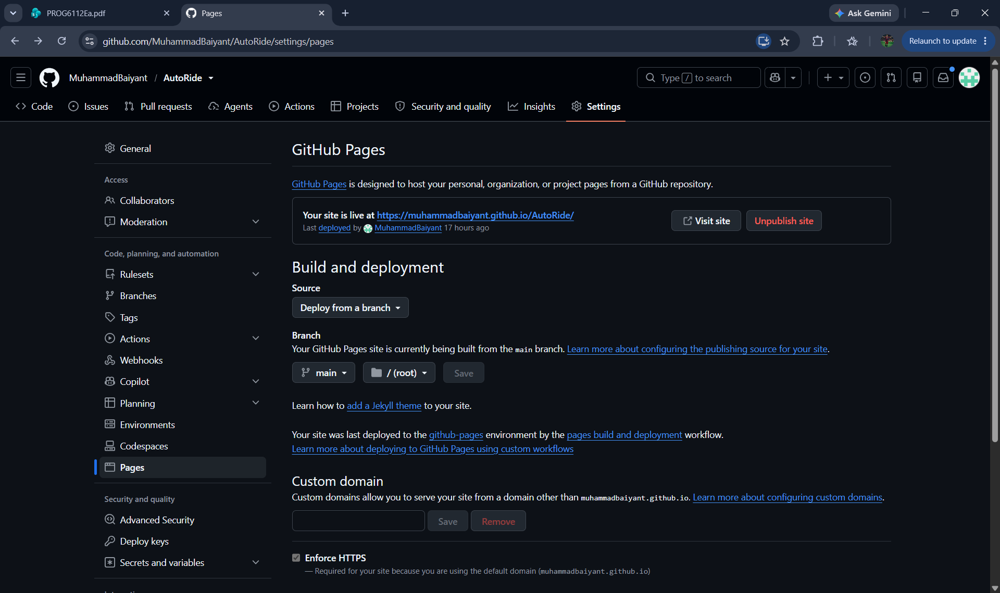
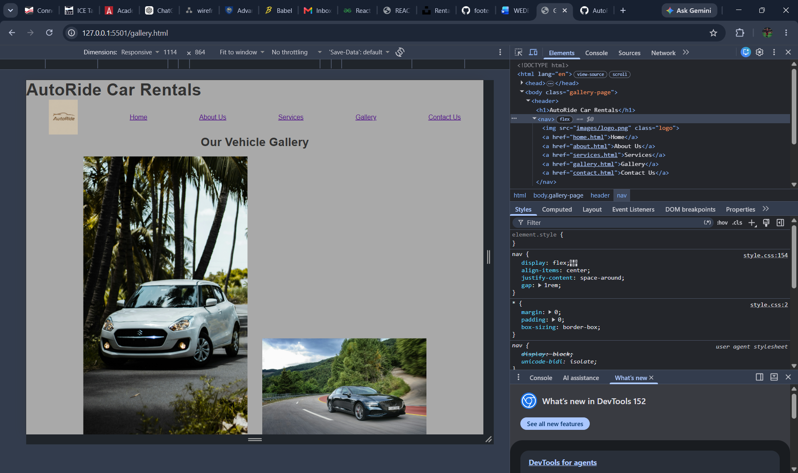
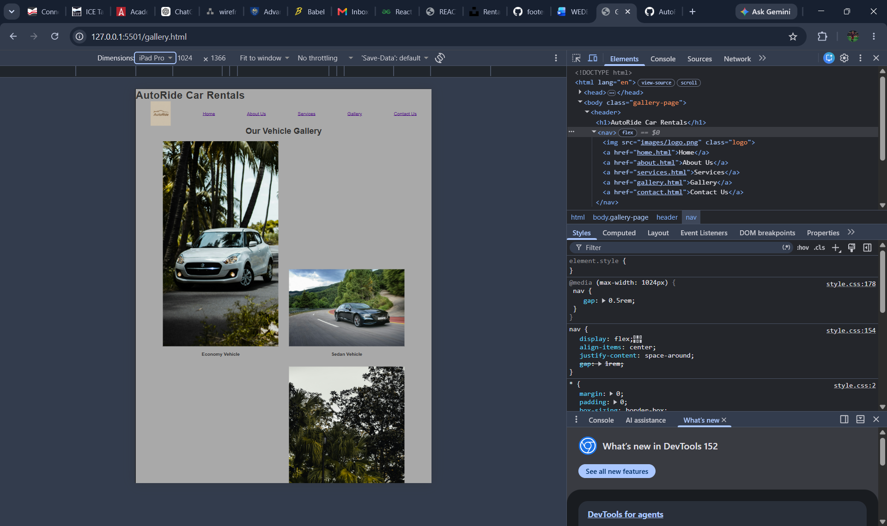
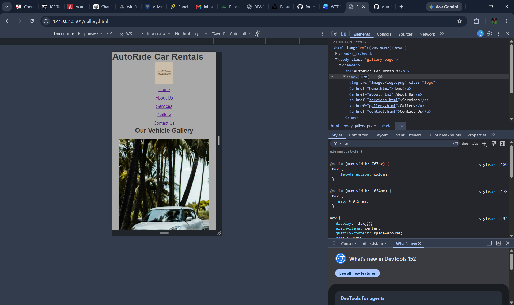

# AutoRide Car Rentals

## Project Description

AutoRide Car Rentals is a car rental website developed to provide customers with information about available vehicles, rental services and prices. The website also allows visitors to make rental enquiries and contact the business.

## Project Documents

Proposal: Available in the document folder.
Sitemap: Available in the document folder.

## Technologies Used

HTML: Used to create the structure and content of the website.
CSS3: Used for styling, layouts and responsive design.
JavaScript: Used to add interactive features and form validation.

## References

W3Schools Online Web Tutorials: Used to learn and understand HTML, CSS and JavaScript concepts.
Skyscanner, Car Hire in Gauteng: Used for ideas and inspiration for the car rental business.
Unsplash: Source of images used in the website.
YouTube: Used for learning how to create a proposal and for the video used on the website.
ChatGPT: Used to understand CSS concepts, answer questions and assist with problem solving during development.

## Changelog

### Part 1

Part 1 completed.
No additions were made to the original Part 1 work.

### Part 2 – CSS

Removed inline CSS to make use of an external CSS file.
Created and implemented style.css.
Added styling for headings, paragraphs, navigation, images, tables and forms.
Added media queries for different screen sizes.
Improved the layout and consistency across the website.

### Part 3 – JavaScript and SEO

Created a JavaScript folder to organise the scripts.
Added an FAQ accordion to the Services page.
Added vehicle search, category filtering and price sorting.
Added a gallery lightbox to enlarge vehicle images.
Created a separate Rental Enquiry page.
Added form validation and date checking to the Rental Enquiry form.
Updated the Contact page with a general contact form.
Added functionality to prepare an email using the visitor's contact details and message.

Note: The Contact form uses a mailto: link, which opens the visitor's default email application. The Rental Enquiry form displays a response but does not store or send the enquiry to a server.

Added unique page titles and meta descriptions.
Improved image filenames and alternative text.
Added internal links between website pages.
Checked mobile responsiveness.
Created robots.txt and sitemap.xml.
Added lazy loading to images and video loading optimisation.
Included basic website security considerations.

Published website to git hub pages, domain and https :
https://muhammadbaiyant.github.io/AutoRide/

## Website Features

Navigation between all website pages.
Responsive layout for desktop, tablet and mobile devices.
Vehicle search and category filtering.
Vehicle price sorting.
Interactive FAQ section.
Gallery lightbox for viewing larger images.
Rental enquiry form with date validation.
Contact form that prepares an email.
Embedded Google Maps location.

## Media Queries

The website uses CSS media queries to adjust the layout for different screen sizes.

### Desktop

### Tablet

### Mobile

## Notes and Future Improvements

### Responsive Images

The srcset and sizes attributes can be used to load different image sizes depending on the visitor's screen.

Example:

html img tag:

src="images/economy-medium.jpg"
srcset="
images/economy-small.jpg 480w,
images/economy-medium.jpg 800w,
images/economy-large.jpg 1200w
"
sizes="(max-width: 767px) 100vw,
(max-width: 1024px) 50vw,
400px"
alt="Economy rental car"

This can improve loading performance by allowing the browser to select a suitable image size.

### Possible Future Improvements

Connect forms to a backend or form service to receive and store customer submissions.
Implement AJAX form submission.
Add more vehicle options and images.
Improve search engine visibility through backlinks and local business listings.
